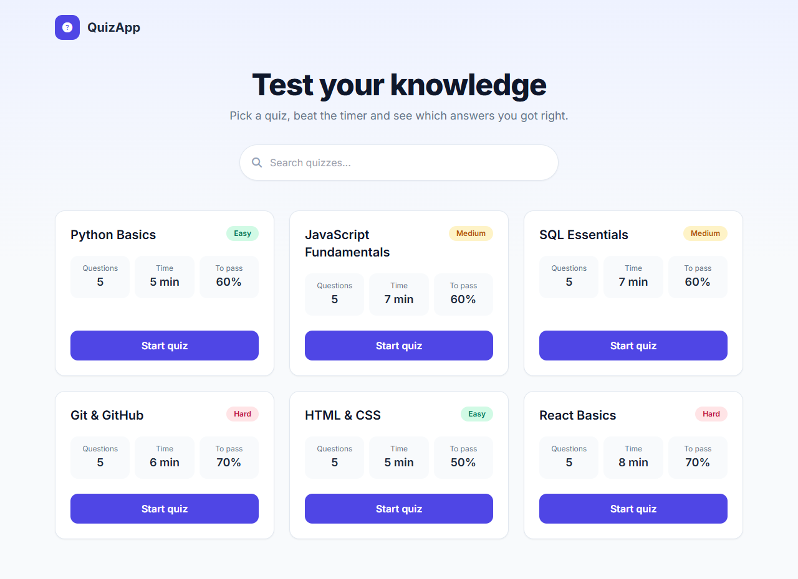
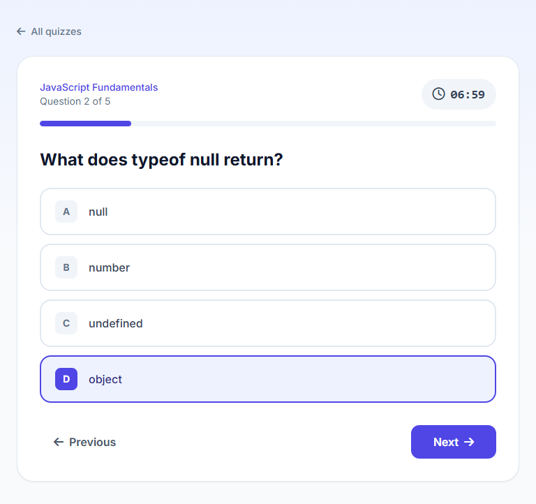
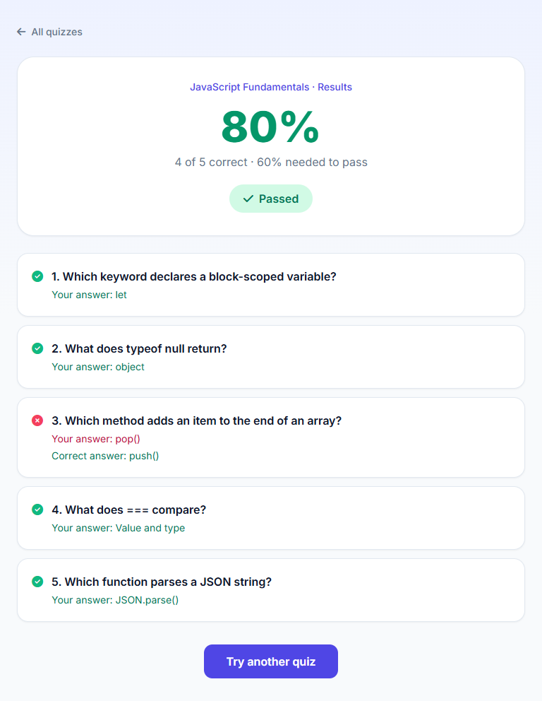

# QuizApp: Django REST + Next.js

A quiz platform where you pick a topic, answer timed multiple-choice questions and get a detailed result page that shows which answers were right, which were wrong and whether you passed.



| Answering a question | Results |
|---|---|
|  |  |

## Features

- **Quiz catalog with live search**: every quiz is listed on the home page. Typing filters by title (case-insensitive, debounced so the API is not called on every key press).
- **Timed quizzes**: each quiz has its own time limit. The timer turns red in the last minute and finishes the quiz automatically at 00:00.
- **Navigation between questions**: you can go back and change an answer. The score is calculated from the final answers, so changing an answer never counts twice.
- **Progress bar** and question counter.
- **Results page**: score in percent, pass/fail against the quiz's own pass mark, and a review of every question with your answer and the correct one.
- **Difficulty levels**: easy, medium and hard, each shown as a colored badge.
- **Demo data** loaded with one command (`seed_quizzes`), safe to run more than once.

## Tech stack

| Layer | Technologies |
|---|---|
| Frontend | Next.js 14 (App Router), React 18, Tailwind CSS, Axios, Font Awesome |
| Backend | Python, Django 5, Django REST Framework, django-cors-headers |
| Database | SQLite by default, MySQL optional |
| Tests | Django test runner (API tests) |

## How it works

```
Next.js (localhost:3000)  ──HTTP/JSON──►  Django REST API (localhost:8000)  ──►  SQLite / MySQL
```

Data model: a `Quiz` has many `QuizQuestion`s, and each question has several `Answer`s (one marked `is_correct`).

| Method | Endpoint | Description |
|---|---|---|
| GET | `/searchQuizes/?search=<text>` | All quizzes, or the ones whose title contains `text` |
| GET | `/quiz/?id=<id>` | One quiz (title, difficulty, time limit, pass mark) |
| GET | `/questions/?id=<id>` | The questions of a quiz, with their answers |

## Getting started

Requirements: Python 3.10+ and Node.js 18+.

**1. Backend**

```bash
cd server
python -m venv venv
venv\Scripts\activate          # macOS/Linux: source venv/bin/activate
pip install -r requirements.txt
copy .env.example .env         # macOS/Linux: cp .env.example .env
python manage.py migrate
python manage.py seed_quizzes  # adds 6 demo quizzes
python manage.py runserver 8000
```

**2. Frontend** (in a second terminal)

```bash
cd client
npm install
npm run dev
```

Open http://localhost:3000.

The frontend reads the API address from `NEXT_PUBLIC_API_URL` (default `http://localhost:8000`, see `client/.env.example`). Quizzes can also be added from the Django admin (`python manage.py createsuperuser`, then http://localhost:8000/admin).

**Tests**

```bash
cd server
python manage.py test
```

## Project structure

```
client/                Next.js frontend
  app/page.jsx         quiz list + search
  app/quiz/[id]/       quiz flow, timer and results
server/                Django backend
  DjangoQuiz/          settings and URLs
  quizApp/             models, serializers, views, tests
  quizApp/management/  seed_quizzes command
```

## What I would add next

- User accounts and a history of past attempts
- Checking the answers on the server, so the correct answers are not sent to the browser
- A page for creating quizzes without the Django admin
